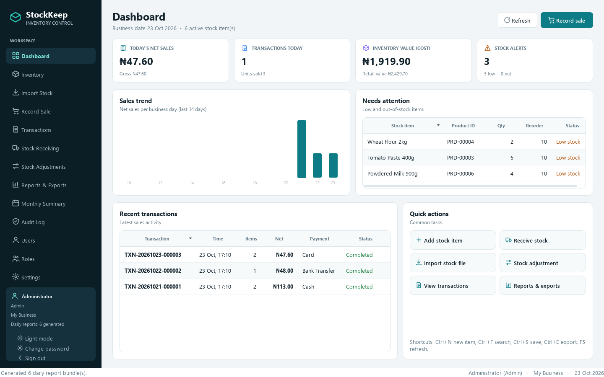
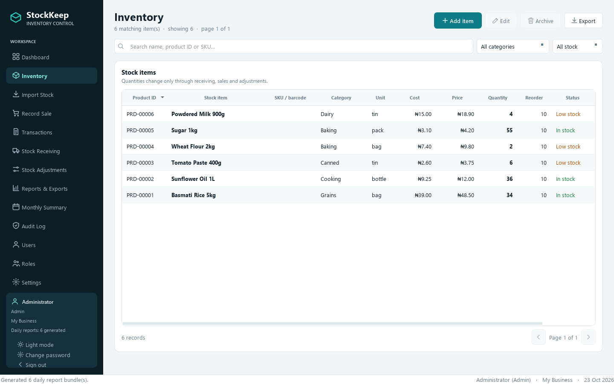
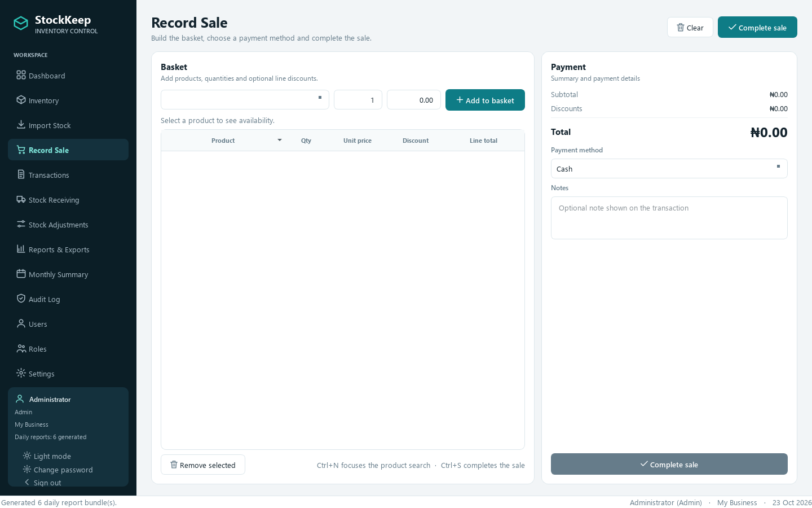
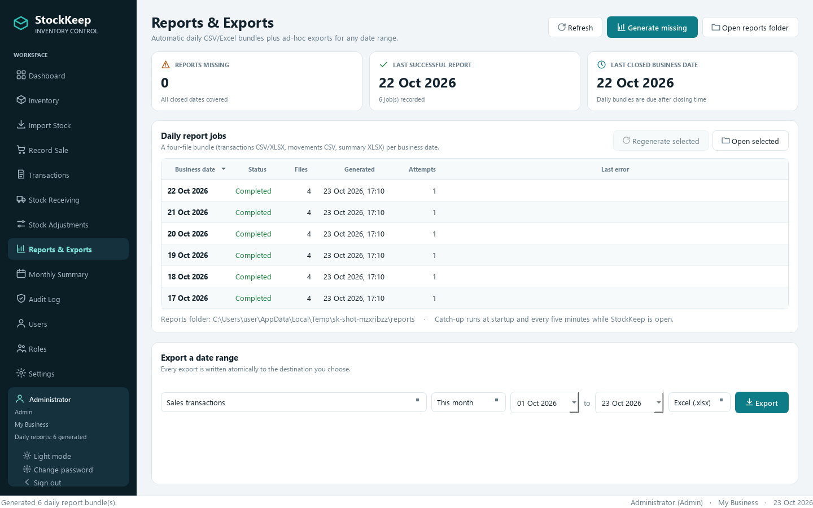
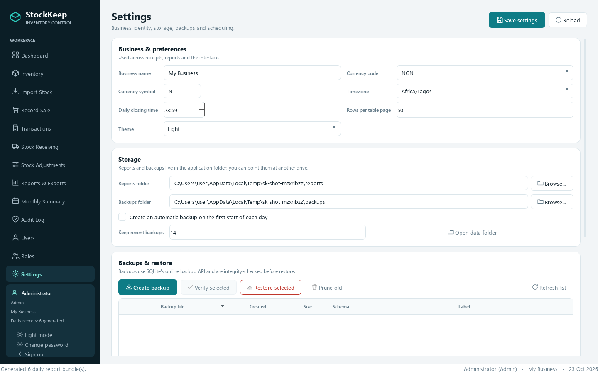
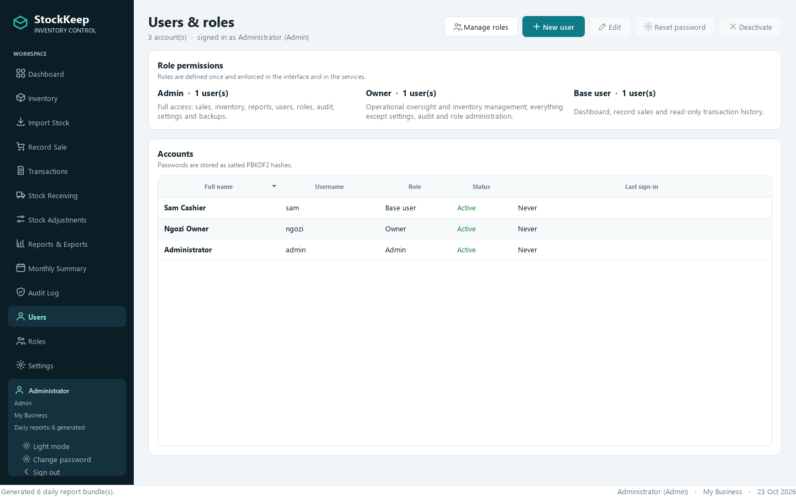
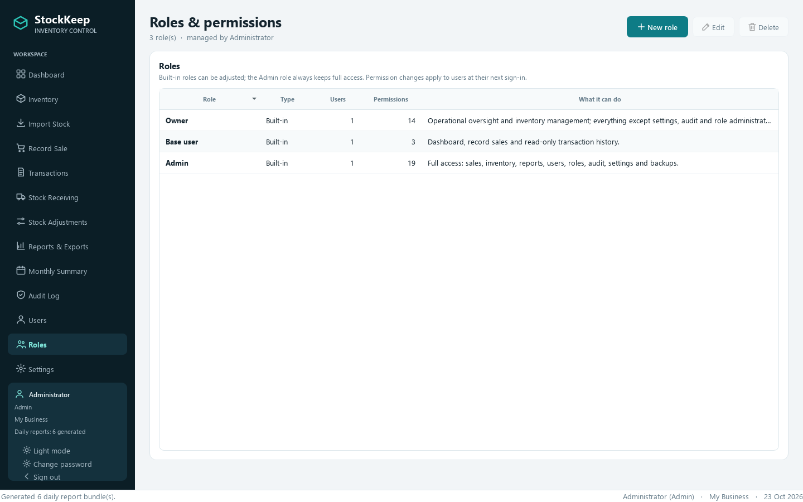
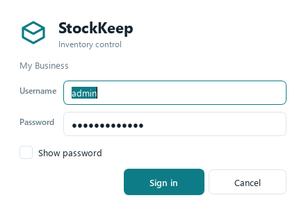

# StockKeep

A native Windows inventory application for small businesses: products, stock
receiving, auditable adjustments, multi-item sales with refunds, automatic daily
reports, monthly summaries and verified backups ÔÇö all in one PySide6 desktop app.
No browser, no web server, no JavaScript: the UI is Qt widgets, the data is SQLite.



## Highlights

- **Role-based access** ÔÇö sign in as Admin, Owner or Base user, or create custom
  roles with exactly the sections and actions you choose.  The default Owner runs
  the operation but cannot open Settings or Audit; Base users get the dashboard,
  the sale counter and read-only transactions.  Access is enforced in navigation
  and in the services.
- **Native desktop UI** ÔÇö PySide6 widgets only, with light/dark themes, a
  persistent sidebar, sortable model/view tables, native dialogs and keyboard
  shortcuts.
- **Exact money and quantities** ÔÇö money is stored as integer minor units
  (kobo/cents) and quantities as integer thousandths (3 decimal places), using
  `Decimal` at the edges. No binary floating point touches financial totals.
  Stock units include pcs, kg, g, litre, ml, pack, box, carton, bag, dozen,
  metre and **yard** ÔÇö so fabric and other length-based goods can be sold in
  fractional yards.
- **Auditable stock ledger** ÔÇö every quantity change (opening stock, receipts,
  sales, returns, damage, loss, expiry, count corrections, imports, reversals)
  is a `StockMovement` row with before/after quantities and a business date.
- **Safe selling** ÔÇö multi-item baskets, line discounts, payment methods,
  atomic conditional stock deduction that prevents overselling, and idempotency
  keys so a retried completion cannot double-charge or double-deduct.
- **Permanent history** ÔÇö sales are never deleted. Corrections are partial
  refunds, full refunds or reversals, each restocking (optionally) and adjusting
  revenue on the correct business date.
- **Automatic daily reports** ÔÇö CSV + XLSX bundles per business date with
  catch-up at startup, every five minutes while open, or from Windows Task
  Scheduler when the app is closed.
- **Fast startup** ÔÇö pages are created only when first opened, so a cashier
  never pays for building inventory, reports or admin screens, and SQLite runs
  with a larger page cache and memory-mapped reads.
- **Backups that can be trusted** ÔÇö SQLite online-backup API, SHA-256 manifest,
  integrity validation before restore, automatic pre-restore safety copy and
  restore rollback if the restored file fails.
- **Transactional imports** ÔÇö CSV/XLSX preview with per-row errors, duplicate
  detection, rejected-row export, and add / update / upsert / privileged replace
  modes that commit all-or-nothing.

| Inventory | Record Sale |
| --- | --- |
|  |  |

| Reports & Exports | Settings |
| --- | --- |
|  |  |

| Users & roles | Roles & permissions |
| --- | --- |
|  |  |

| Sign in | Dashboard |
| --- | --- |
|  |  |

## Install for normal use

Download the latest Windows setup from **GitHub Releases**:

**https://github.com/Enendugodwin/StockKeep-inventory-/releases/latest**

Run `StockKeepSetup-1.2.0.exe`, choose a folder and launch StockKeep from the
Start Menu.  The installer is per-user, installs only `StockKeep.exe` and does
not delete your database, reports, backups or logs when you uninstall.  The
build is not code-signed yet, so Windows SmartScreen may ask you to confirm the
first launch.

## Quick start

Requires Windows 10/11 and Python 3.12+ (tested with 3.13).

```powershell
cd StockKeep
py -3.13 -m venv .venv
.venv\Scripts\python -m pip install --upgrade pip
.venv\Scripts\python -m pip install -r requirements.txt
.venv\Scripts\python run.py
```

`run.py` is the development launcher. The packaged build (`dist\StockKeep.exe`)
needs no Python installation.

On first start StockKeep creates its data directory and shows a **first-run
setup** asking you to create the administrator account (full name, username and
a password of at least 8 characters). Sign in with that account afterwards.

## Roles and access

| Section | Admin | Owner | Base user |
| --- | :---: | :---: | :---: |
| Dashboard | Ô£ô | Ô£ô | Ô£ô |
| Inventory (view/add/edit) | Ô£ô | Ô£ô | |
| Import Stock | Ô£ô | Ô£ô | |
| Stock Receiving / Adjustments | Ô£ô | Ô£ô | |
| Record Sale | Ô£ô | Ô£ô | Ô£ô |
| Transactions | Ô£ô | Ô£ô | read-only |
| Refunds / reversals | Ô£ô | Ô£ô | |
| Reports & Exports / Monthly Summary | Ô£ô | Ô£ô | |
| Audit Log | Ô£ô | | |
| Users | Ô£ô | read-only | |
| Roles & permissions | Ô£ô | read-only | |
| Settings and backups | Ô£ô | | |
| Change own password | Ô£ô | Ô£ô | Ô£ô |

The Admin can create **custom roles** under **Roles & permissions** and tick
exactly what each role can do and see.  The two built-in roles can also have
their permissions adjusted, but their names stay fixed.  The Admin role always
keeps full access and cannot be edited or deleted.

The default Owner has every operational permission ÔÇö including sales, refunds,
inventory, reports, users and roles (both read-only) and monthly summaries ÔÇö but
cannot open Settings or Audit, and cannot edit roles.  The default Base user sees
the dashboard, can record sales, and sees transaction history read-only.  Role
editing is deliberately admin-only so an Owner cannot grant themselves Settings
access; Owners can still see the role list and permission counts.

Permissions are enforced twice: unauthorised sections are not shown in the
sidebar, and the primary service functions reject calls from a role without the
permission.  Role changes apply to signed-in users at their next sign-in.
Account and role changes are written to the audit log (passwords are never
logged).

## Where data lives

StockKeep is portable: everything writable is kept in the **application folder**
ÔÇö the project root when running from source (or from this project's
`dist\StockKeep.exe`), and otherwise the folder containing `StockKeep.exe`.
Nothing is written to `%LOCALAPPDATA%`, `%APPDATA%` or the user profile.

| Item | Default location |
| --- | --- |
| Home | the application folder |
| Database | `<app folder>\database\stockkeep.db` |
| Daily reports | `<app folder>\reports\YYYY\MM\DD\` |
| Backups | `<app folder>\backups\` |
| Logs | `<app folder>\logs\stockkeep.log` |
| Exports | `<app folder>\exports\` |

Set `STOCKKEEP_HOME` (or pass `--home PATH`) to use a different home directory ÔÇö
useful for a shared drive, a USB stick or tests. Report and backup folders can
also be changed independently in **Settings**.

If a 1.0 installation left data in `%LOCALAPPDATA%\StockKeep`, the first launch
of 1.1 moves it into the application folder automatically (the old folder is
removed only after a successful copy).

## The thirteen sections

1. **Dashboard** ÔÇö today's net sales, transaction count, inventory value, stock
   alerts, 14-day sales trend, low-stock list and recent transactions.
2. **Inventory** ÔÇö search/filter/paginate products, create and edit items,
   archive/restore, export the current view.
3. **Import Stock** ÔÇö choose CSV/XLSX, preview validation results, pick a mode,
   apply, and export rejected rows.
4. **Record Sale** ÔÇö searchable product picker, basket with quantities and line
   discounts, payment method, notes, atomic completion and a receipt.
5. **Transactions** ÔÇö every sale with status; view details, refund/reverse,
   export the filtered range, print/reopen receipts.
6. **Stock Receiving** ÔÇö receive stock from a supplier, update the cost price
   and record a reference/note.
7. **Stock Adjustments** ÔÇö record damage, loss, expiry or a physical count
   correction, always with a reason.
8. **Reports & Exports** ÔÇö daily job status, regenerate/open bundles, and export
   sales, daily summaries, stock movements, inventory, low stock, product
   performance and audit logs for any date range.
9. **Monthly Summary** ÔÇö reconcile monthly sales, COGS, profit, payments, stock
   movements and per-product performance; export XLSX or a CSV set.
10. **Audit Log** ÔÇö who changed what, when, with reasons and JSON details.
11. **Users** ÔÇö see accounts and their roles; Admins can create accounts,
    choose any role, activate/deactivate and reset passwords.
12. **Roles & permissions** ÔÇö create custom roles and tick the exact sections
    and actions each role may use (Admin only; the Admin role is immutable).
13. **Settings** ÔÇö business name, currency, timezone, closing time, theme,
    page size, storage folders, backup policy, scheduled task and diagnostics
    (Admin only).

## Keyboard shortcuts

| Shortcut | Action |
| --- | --- |
| `Ctrl+N` | New item (context dependent) |
| `Ctrl+F` | Focus the page search box |
| `Ctrl+S` | Save / apply the page action |
| `Ctrl+E` | Export |
| `F5` | Refresh the current page |

Destructive actions (archive, replace import, restore, refund/reversal) ask for
confirmation; replacing inventory requires typing `REPLACE`.

## Import file format

The importer accepts `.csv` (UTF-8/UTF-16/CP1252, comma/semicolon/tab/pipe
delimited) and `.xlsx`. Download a ready-made template from **Import Stock**.

Required columns (aliases are matched case-insensitively):

| Column | Aliases | Required |
| --- | --- | --- |
| Stock Name | `name`, `product name` | yes |
| Price | `selling price`, `unit price` | yes |
| Amount in Inventory | `quantity`, `qty`, `stock` | yes |
| Product ID | `product code`, `code` | no |
| SKU / barcode | `sku`, `barcode` | no |
| Category | `group` | no |
| Cost Price | `cost`, `buying price` | no |
| Reorder Level | `minimum stock`, `reorder point` | no |
| Unit | `uom`, `unit of measure` | no (defaults to `pcs`) |

Preview flags missing names, non-numeric/negative values, invalid product IDs,
duplicate rows in the file and rows that update the same product twice. Modes:

- **Add new** ÔÇö create only rows that do not match an existing product.
- **Update existing** ÔÇö update matched products and set their quantity.
- **Upsert** ÔÇö create or update.
- **Replace inventory** ÔÇö update/create the listed products and archive all
  other active products (their stock is removed with an audited movement). This
  mode requires explicit confirmation and a file with no rejected rows.

Quantity changes made by an import are written to the stock ledger as `import`
movements; nothing is silently overwritten.

## Reports

For every closed business date StockKeep writes four files:

```
reports/YYYY/MM/DD/
Ôö£ÔöÇÔöÇ transactions_YYYY-MM-DD.csv
Ôö£ÔöÇÔöÇ transactions_YYYY-MM-DD.xlsx   # Transactions, Daily Summary, Stock Movements
Ôö£ÔöÇÔöÇ stock_movements_YYYY-MM-DD.csv
ÔööÔöÇÔöÇ daily_summary_YYYY-MM-DD.xlsx  # Daily Summary, Stock Movements
```

Header rows are row 1 in every sheet so the files are directly machine-readable.
Revenue rules:

- Reversed sales are excluded from revenue entirely.
- Refunds are subtracted on the **refund's** business date, not the original
  sale date.
- Stock movements remain the source of truth for quantities.

The scheduler catches up from the earliest recorded activity (up to 400 days),
records a `ReportJob` per date with attempts and errors, retries failed dates,
and uses a lock file so two runs cannot write the same bundle concurrently.

### Windows Task Scheduler

From **Settings  Automatic daily reports** choose *Install task* (or run
`StockKeep.exe --install-task`). The task runs at the configured closing time:

```powershell
.venv\Scripts\python -m stockkeep --install-task
.venv\Scripts\python -m stockkeep --task-status
.venv\Scripts\python -m stockkeep --remove-task
```

## Backups and restore

- **Create backup** uses SQLite's online backup API against a live database.
- Each backup gets a `stockkeep_*.db.json` manifest with size, schema version
  and SHA-256 checksum.
- **Verify selected** checks integrity, checksum and schema compatibility.
- **Restore selected** validates the file, creates a `pre-restore` backup, swaps
  the database, runs `PRAGMA integrity_check` and rolls back automatically if
  the restored file is unusable.
- Retention prunes only old `stockkeep_*.db` files and their manifests.

## Command line

```powershell
python -m stockkeep                      # launch the GUI
python -m stockkeep --generate-reports   # generate missing daily reports
python -m stockkeep --generate-reports --date 2026-10-01 --force
python -m stockkeep --diagnostics        # paths, schema, counts, integrity
python -m stockkeep --home D:\StockKeepData
python -m stockkeep --verbose
```

## Building the executable

```powershell
powershell -ExecutionPolicy Bypass -File build.ps1
```

The script runs the tests, regenerates `assets\stockkeep.ico`, then builds a
single windowed executable at `dist\StockKeep.exe` with PyInstaller. Use
`-SkipTests` or `-SkipClean` to shorten the loop.

Manual equivalent:

```powershell
$env:PYTHONPATH = "src"
.venv\Scripts\python -m pytest tests
.venv\Scripts\python tools\make_icon.py
.venv\Scripts\pyinstaller.exe --clean --noconfirm StockKeep.spec
```

The spec bundles `tzdata` (so `Africa/Lagos` resolves on a clean Windows
machine) and excludes test-only packages. The portable data folders
(`database`, `reports`, `backups`, `logs`, `config`, `exports`) sit next to
`StockKeep.exe`; rebuilding replaces only the executable, so business data is
untouched. When the exe is run from the project's `dist` folder, the project
root is used instead, so the source and packaged apps share one data folder.
To move the installation, copy the whole folder.

## Building the installer

The setup program is built with [Inno Setup 6](https://jrsoftware.org/isinfo.php):

```powershell
powershell -ExecutionPolicy Bypass -File build-setup.ps1
```

It builds `dist\StockKeep.exe` first (tests included), then writes
`dist\StockKeepSetup-1.2.0.exe`. Use `-SkipTests` or `-SkipAppBuild` to shorten
the loop. The installer is per-user and defaults to `%USERPROFILE%\StockKeep`,
the app's existing portable folder; the destination can be changed in the
wizard. It installs only `StockKeep.exe` (plus Start Menu/optional desktop
shortcuts), so uninstalling never deletes the database, reports, backups or
logs. The executable is not code-signed, so Windows SmartScreen may ask you to
confirm the first launch. If Inno Setup is missing:

```powershell
winget install --id JRSoftware.InnoSetup -e
```

## Performance notes

- Pages are built lazily on first visit (`MainWindow.go_to`), which keeps login
  fast even with years of history. A Base user only ever builds the sale page.
- SQLite is tuned for desktop use: WAL journal, `synchronous=NORMAL`, a 64 MB
  page cache, 256 MB memory-mapped reads, in-memory temp tables and a bounded
  WAL file. Indexes cover product names/categories, sale dates, stock movements
  and audit history.
- Tables are paged, report queries aggregate in SQL, and backup copies use the
  SQLite online-backup API instead of loading rows into Python.

## Development

```
src/stockkeep/
Ôö£ÔöÇÔöÇ models.py           SQLAlchemy models, constants, money/qty properties
Ôö£ÔöÇÔöÇ db.py               engine pragmas, schema versioning, migrations, seed
Ôö£ÔöÇÔöÇ money.py            Decimal/minor-unit conversion and formatting
Ôö£ÔöÇÔöÇ timeutil.py         timezone-aware business dates and closing times
Ôö£ÔöÇÔöÇ atomic.py           SAVEPOINT decorator for all-or-nothing services
Ôö£ÔöÇÔöÇ services/
Ôöé   Ôö£ÔöÇÔöÇ catalog.py      product CRUD, paging, history
Ôöé   Ôö£ÔöÇÔöÇ stock.py        receiving, adjustments, returns, ledger writes
Ôöé   Ôö£ÔöÇÔöÇ sales.py        baskets, atomic deduction, refunds, reversals
Ôöé   Ôö£ÔöÇÔöÇ imports.py      parsing, validation, preview, apply, templates
Ôöé   Ôö£ÔöÇÔöÇ analytics.py    dashboard, summaries, transaction/movement queries
Ôöé   Ôö£ÔöÇÔöÇ reports.py      daily bundles, exports, monthly workbooks
Ôöé   Ôö£ÔöÇÔöÇ scheduler.py    catch-up, lock, Task Scheduler integration
Ôöé   Ôö£ÔöÇÔöÇ backup.py       backup, verify, restore, prune, auto-backup
Ôöé   Ôö£ÔöÇÔöÇ audit.py        audit events with JSON-safe details
Ôöé   ÔööÔöÇÔöÇ settings_service.py
ÔööÔöÇÔöÇ ui/
    Ôö£ÔöÇÔöÇ main_window.py  sidebar, stacked pages, shortcuts, maintenance timer
    Ôö£ÔöÇÔöÇ theme.py        light/dark palettes and QSS
    Ôö£ÔöÇÔöÇ widgets.py      cards, KPI tiles, tables, pagination, bar chart
    Ôö£ÔöÇÔöÇ dialogs.py      product/sale/refund/receipt/audit dialogs
    Ôö£ÔöÇÔöÇ workers.py      QThreadPool workers with progress dialogs
    ÔööÔöÇÔöÇ pages/          one module per navigation section
```

### Database rules

- Schema version lives in `PRAGMA user_version`; bump `SCHEMA_VERSION` and add a
  migration step in `db.migrate` for every schema change.
- Migrations run automatically on open. Backups from a newer schema are refused.
- SQLite runs in WAL mode with `busy_timeout=30000`; keep write sessions short.
- Services that must be atomic (`create_sale`, `refund_sale`, `apply_import`)
  run inside SAVEPOINTs, so a caught error still rolls back only that operation.

### Tests

```powershell
$env:PYTHONPATH = "src"
$env:QT_QPA_PLATFORM = "offscreen"
.venv\Scripts\python -m pytest tests
```

The suite covers money rounding, timezone/closing logic, sales and oversell
atomicity, idempotency, refunds/reversals, stock movements, import preview and
all four modes, import rollback, daily reports and catch-up, monthly
reconciliation, export formats, backup/verify/restore/prune, password hashing,
first-run setup, login, role permissions, last-admin protection, and a headless
GUI smoke test that builds the window and visits every page.

A few helper scripts live in `tools/`: `ui_smoke.py` (page walk), `screenshot.py`
(README images) and `make_icon.py` (icon assets). They all use throwaway
databases.

## Operational notes

- The UI is single-user at a time. Two copies of StockKeep can run against the
  same database, but write concurrency is limited by SQLite; the app is designed
  for one signed-in operator on one PC.
- Accounts and salted PBKDF2 password hashes live in the SQLite database, so
  anyone with access to the application folder can copy the file. Role-based
  access protects against accidental or casual misuse in the app, not against
  someone who owns the PC; use Windows file permissions and full-disk
  encryption if that matters.
- Reports and backups are plain files. Copy them to another drive or cloud
  storage for disaster recovery.
- If a report date is corrected after its bundle was written, the job is marked
  stale and the next run regenerates it.
- The packaged executable is windowed, and Task Scheduler helper commands run
  with a hidden console, so normal use does not flash a Command Prompt window.

## Contributing and security

See [CONTRIBUTING.md](CONTRIBUTING.md) for development setup, tests and database
migration rules, and [SECURITY.md](SECURITY.md) for reporting a vulnerability.
Do not attach a real database, backup, report or log to an issue.

## License

MIT ÔÇö see [LICENSE](LICENSE).

## Version

StockKeep 1.2.0 ÔÇö schema version 4.
